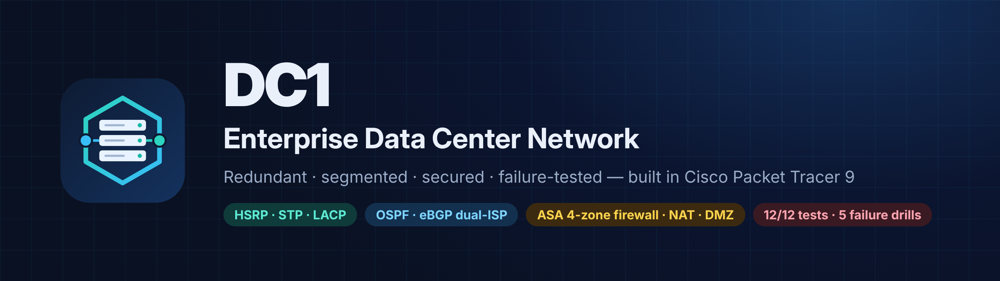
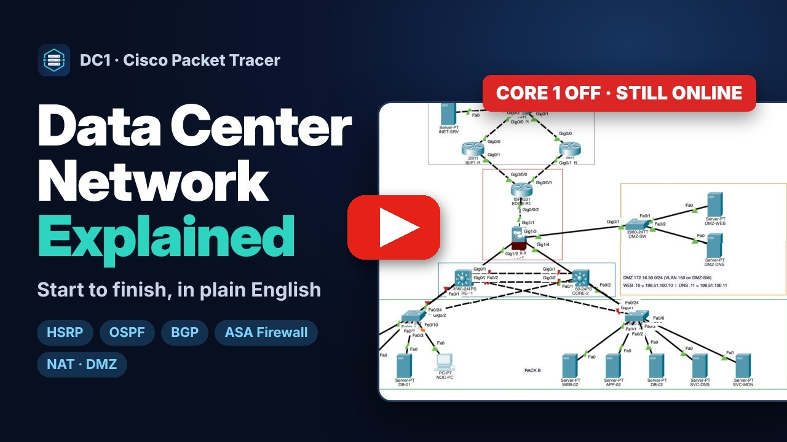
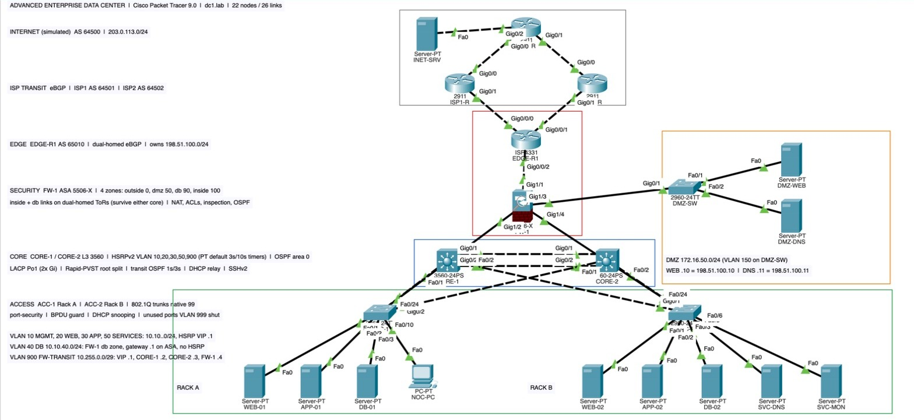
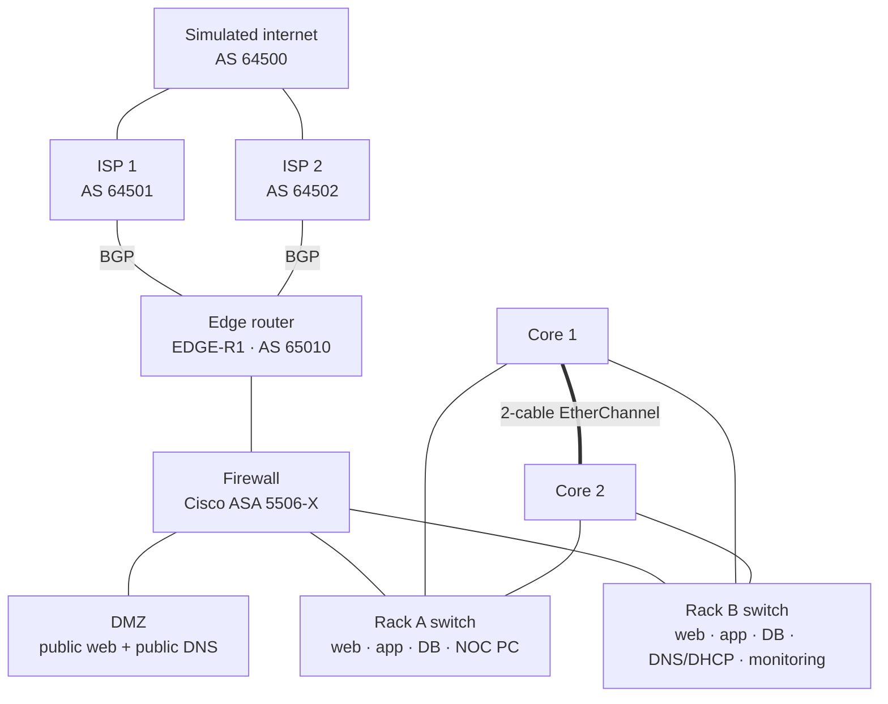
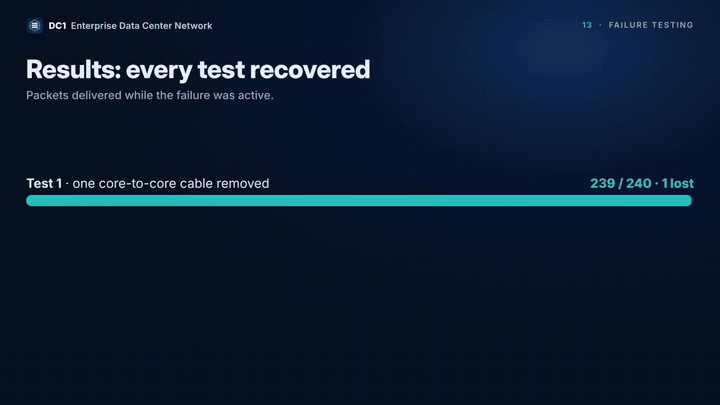
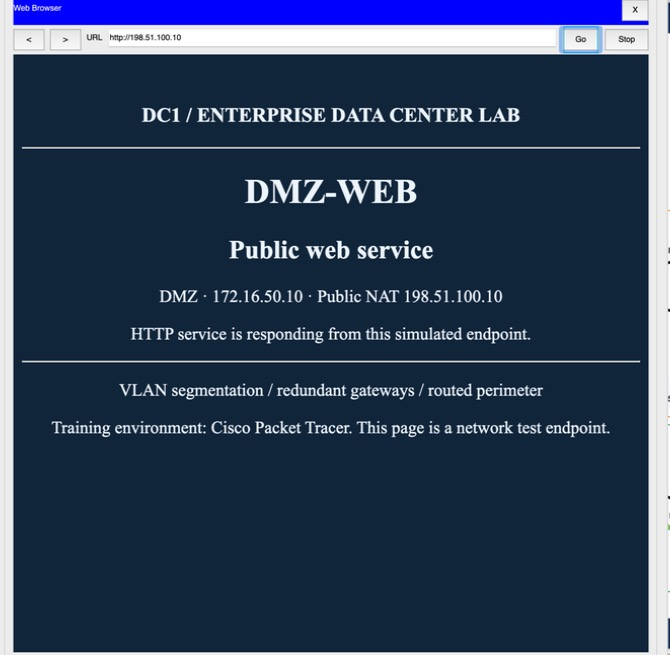
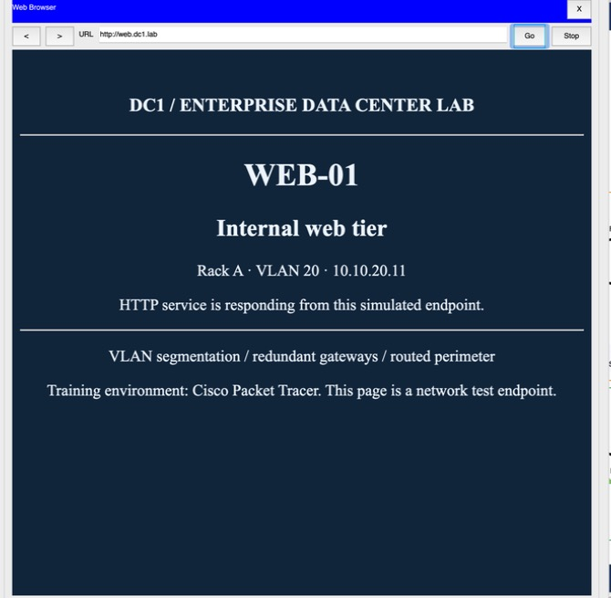

  

  <b>A redundant, secured enterprise data center network: built, tested and broken on purpose in Cisco Packet Tracer 9.</b>

  
  
  
  
  

  <a href="#watch-the-walkthrough">Video</a> ·
  <a href="#the-network-in-one-minute">In one minute</a> ·
  <a href="#the-topology">Topology</a> ·
  <a href="#how-it-works-layer-by-layer">How it works</a> ·
  <a href="#proof-that-it-works">Proof</a> ·
  <a href="#try-it-yourself">Try it</a>

---

## Watch the walkthrough

  

A 16-minute narrated tour of the whole network. It covers what each part is, why it is there and why it matters. Then it shows live tests and failure drills.

**▶ [Watch on YouTube](https://youtu.be/VVfJT8srvqo)**. The video has chapters for every topic and English captions.

---

## The network in one minute

A **data center** is a room full of servers that run websites, applications and databases.
The **data center network** connects those servers to each other, to the engineers who manage them, and to the internet.

DC1 answers the three questions every real design must answer:

| Question | Answer in this lab |
| --- | --- |
| **Does it stay up when something fails?** | Two core switches, two internet providers, and every rack wired to both cores. Any single core, cable or ISP link can fail and traffic keeps flowing. |
| **Does it keep systems apart?** | Web, application and database servers live in separate networks (VLANs). A firewall decides who may talk to whom. |
| **Is it secure and manageable?** | SSH-only logins, accepted only from the management network. Port security, BPDU guard and DHCP snooping on rack ports. Central logs and time. |

---

## The topology

---

## How it works, layer by layer

Read it top to bottom, the way traffic arrives from the internet.

| Layer | What it is | Why it is there |
| --- | --- | --- |
| **Internet + two ISPs** | A simulated internet and two internet providers | If one provider fails, the business stays online |
| **Edge router** | Our front door to the internet, running **BGP** with both providers | Announces our public addresses and moves traffic to the working provider automatically |
| **Firewall** | A Cisco ASA with four zones: outside (0), DMZ (50), database (90), inside (100) | Inspects every packet that crosses a zone and allows only what we permit |
| **DMZ** | A separate zone for the only servers the public may reach | A hacked public server cannot reach anything inside |
| **Core switches** | Two Layer 3 switches that route between all internal networks | Each core can take over for the other (**HSRP**, **OSPF**, **EtherChannel**) |
| **Rack switches** | One top-of-rack switch per rack, with a cable to *each* core | If a core fails, no rack is cut off (**Rapid Spanning Tree** picks the backup path) |
| **Servers and services** | Web, app and database servers, DNS/DHCP, syslog/NTP and a management PC | The workloads, plus the services every network needs |

### Key ideas in plain English

| Term | What it is | Why we use it |
| --- | --- | --- |
| **VLAN** | Splits one physical switch into separate networks | Keeps web, app and database apart; traffic between them must pass a router or firewall |
| **Trunk (802.1Q)** | One cable that carries many VLANs by tagging each frame | Fewer cables, and the VLANs still stay separate |
| **Spanning tree** | Keeps one path active and holds backup paths in standby | Redundant cables without traffic looping forever |
| **EtherChannel (LACP)** | Two cables that act as one link | More bandwidth; one cable can fail with no outage |
| **HSRP** | Two switches share one virtual gateway address | If the active gateway dies, the standby takes over and servers notice nothing |
| **OSPF** | Routers share the networks they know about automatically | Finds a new path by itself when something fails |
| **BGP** | The routing protocol between organizations on the internet | Lets us use two providers and fail over between them |
| **NAT / PAT** | The firewall swaps private addresses for public ones | Private addresses can't be used on the internet; many servers share one public address |
| **DMZ + static NAT** | Public servers in their own zone, each with a fixed public address | The public reaches only what it should |

### Who can talk to whom

| | Flow | Why |
| --- | --- | --- |
| ✅ | App, management and service servers → databases | They need the data |
| ❌ | Web servers → databases | A hacked web server can't reach the data |
| ❌ | Databases → internet, and most new connections out | Data can't be sent out |
| ❌ | DMZ → internal networks | A hacked public server stays contained |
| ✅ | Internet → public web and public DNS only | Everything else from outside is dropped |

### Addressing

Show the IP plan

| VLAN / zone | Subnet | Gateway |
| --- | --- | --- |
| 10 Management | 10.10.10.0/24 | HSRP .1 (Core 1 active), DHCP pool .100–.149 |
| 20 Web | 10.10.20.0/24 | HSRP .1 (Core 2 active) |
| 30 Application | 10.10.30.0/24 | HSRP .1 (Core 1 active) |
| 40 Database | 10.10.40.0/24 | Firewall .1 (no core gateway) |
| 50 Shared services | 10.10.50.0/24 | HSRP .1 (Core 1 active), DNS/DHCP .10, syslog/NTP .20 |
| 900 Firewall transit | 10.255.0.0/29 | VIP .1, Core 1 .2, Core 2 .3, firewall .4 |
| DMZ | 172.16.50.0/24 | Firewall .1, web .10, DNS .11 |
| Public | 198.51.100.0/24 | Static NAT: web .10, DNS .11 |
| Simulated internet | 203.0.113.0/24 | INET-R .1, INET-SRV .10 |

Every cable, interface and address is listed in [topology-handoff.md](topology-handoff.md).

---

## Proof that it works

**Acceptance test.** Twelve traffic flows run at once: eight that must work and four that must be blocked.
The lab passed **12/12 before saving** and **12/12 again after the saved file was reopened**.

**Failure drills.** Each drill breaks something while continuous pings are running:

| Drill | What broke | Packets delivered during the failure | Result |
| --- | --- | --- | --- |
| 1 | One of the two core-to-core cables | 239 / 240 | EtherChannel stayed up |
| 2 | A rack switch's main uplink | 200 / 200 | Spanning tree switched over with zero loss |
| 3 | The active internet provider link | 130 / 150 | BGP moved traffic to the other provider |
| 4 | Core 1 powered off | 215 / 250 | Core 2 took over every gateway (7 packets lost per stream) |
| 5 | Core 2 powered off | 222 / 250 | Core 1 took over; internet traffic lost nothing |

These are simulator results. They show behavior, not real-world speed.

  
   
  From the walkthrough video: packets delivered while each failure was active.

| Public website through static NAT | Internal website by DNS name |
| --- | --- |
|  |  |

The full record, with raw output for every test, is in [lab-support/evidence/RESULTS.md](lab-support/evidence/RESULTS.md).

---

## Try it yourself

1. Open **`Advanced-DataCenter.pkt`** in Cisco Packet Tracer 9.0. Allow the script prompt. The small embedded script only disables two firewall proxy-ARP flags and clears two ARP caches.
2. Wait **1–2 minutes** in Realtime mode so the network settles.
3. **NOC-PC → Desktop → IP Configuration → DHCP.** You should get `10.10.10.100`, gateway `10.10.10.1` and DNS `10.10.50.10`.
4. **NOC-PC → Web Browser → `http://web.dc1.lab`** loads the internal website.
5. **APP-01:** `ping 10.10.40.11` works. **WEB-01:** the same ping is blocked by the firewall.
6. **NOC-PC:** `ssh -l netadmin 10.10.10.2` logs in to Core 1 (lab-only password `DcLabOnly2026!`).
7. **Break something.** Power off CORE-1 and watch CORE-2 take over (`show standby brief`). Then power it back on.

Useful commands: `show standby brief` · `show etherchannel summary` · `show spanning-tree vlan 10` · `show ip ospf neighbor` · `show ip bgp`.
On the firewall: `show route` · `show nat` · `show access-list`.

---

## What the testing taught us

1. **"Accepted" is not "applied."** Faster HSRP timers were accepted without an error, but the simulator saves them under the wrong group, so they vanish after a reload. Comparing running configs with the source caught it. Always verify what the device is actually running.
2. **Test the saved file, not just the live session.** After reopening, one test failed because a server kept a stale address entry. A small script inside the lab file now fixes it on every open.
3. **Never weaken security to get a passing test.** The simulated firewall doesn't track replies for some outbound web connections. Extra holes would make those tests pass but weaken the design, so they are documented as simulator limits instead.

The tests also changed the design. Database rules first sat on the core switches, where the simulator accepted them but never enforced them, so the database tier moved behind the firewall. A failover drill showed the firewall's database cable was a hidden single point of failure, so both firewall links moved onto the dual-homed rack switches.

## Honest limits

- It is a simulation, so results show behavior, not real-world speed.
- There is one firewall and one edge router. That is core and path redundancy, not a fully redundant site.
- VXLAN/EVPN, vPC and firewall failover pairs are not available in Packet Tracer, so they are not claimed.
- Two web tests that start from inside the firewall fail because of a simulator limit. They are documented, not hidden.

---

## Repository map

| Path | What's inside |
| --- | --- |
| `Advanced-DataCenter.pkt` | The finished lab |
| [`topology-handoff.md`](topology-handoff.md) | Source of truth: devices, all 26 cables, VLANs, IP plan, routing, firewall policy, change log |
| [`lab-support/configs/`](lab-support/configs/) | Configuration for every network device |
| [`lab-support/evidence/`](lab-support/evidence/) | Test results, raw outputs and as-built running configs |
| [`lab-support/VALIDATION.md`](lab-support/VALIDATION.md) | The test plan: acceptance flows and failure drills |
| [`automation/`](automation/) | Packet Tracer JavaScript automation used to build, configure, test and audit the lab |
| [`video/`](video/) | Narration script and voice generator for the walkthrough video |
| `docs/` | Images and branding used in these documents |

## Skills demonstrated

Data center and campus design · VLANs and 802.1Q trunking · Rapid-PVST · HSRPv2 · LACP EtherChannel · OSPF tuning ·
eBGP dual-homing · Cisco ASA zones, ACLs, NAT/PAT and inspection · DMZ and split DNS · DHCP relay and snooping ·
SSH hardening and port security · failure testing and root-cause analysis · network automation · technical documentation.

---

Built in Cisco Packet Tracer 9.0. All credentials are disposable lab values. Packet Tracer models a subset of real IOS/ASA behavior.
