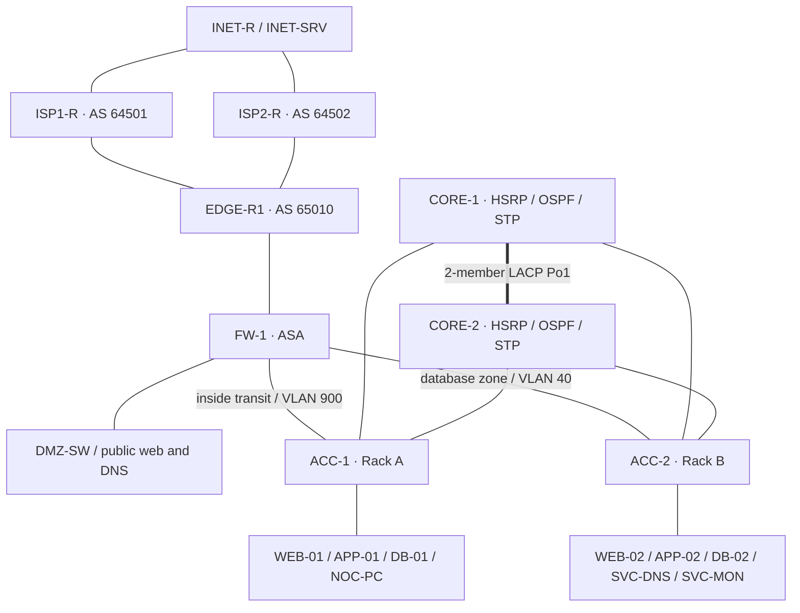

# DC1 advanced data center network lab

Construction target: **22 devices, 26 physical links**, Cisco Packet Tracer 9.0.
The design practices redundancy, network segmentation, routing, perimeter NAT,
public services and troubleshooting in one isolated simulator project.

**Status: accepted with documented simulator limitations.** The 12-flow acceptance
suite passes 12/12 before save and after reopening the saved file, and all
final-design failure drills recovered. Full record: [evidence/RESULTS.md](evidence/RESULTS.md).
Configuration source consistency is checked separately in
[evidence/STATIC-AUDIT.md](evidence/STATIC-AUDIT.md). Source checks do not prove
that configurations are installed or traffic tests pass.

## Files

| Item | Purpose |
| --- | --- |
| `../Advanced-DataCenter.pkt` | Final Packet Tracer lab (accepted; see results record). |
| `../topology-handoff.md` | Device models, exact cabling, VLANs, IP plan and intended routing. |
| `configs/` | Ten IOS/ASA configuration source files. |
| [CONFIGURATION-NOTES.md](CONFIGURATION-NOTES.md) | Application order, lab credentials, model limitations, optional AAA and static routing fallback. |
| [SERVER-SERVICES.md](SERVER-SERVICES.md) | Endpoint settings, DHCP/DNS records, HTTP, monitoring and backup exercises. |
| `server-pages/` | Eight HTTP identity pages for direct service verification. |
| [VALIDATION.md](VALIDATION.md) | Baseline checks, positive/negative flow tests and exact fault/restore exercises. |
| `lab-manifest.json` | Machine-readable static host settings and cable map. |
| `generate_configs.py` | Recreates the source configs; does not control Packet Tracer. |
| `model-workarounds.js` | v1.1: the only script embedded in the final `.pkt` (runs on open). Disables FW-1 proxy ARP on Gi1/2/Gi1/4 and flushes DB-01/DB-02 ARP caches. |
| `../backups/DataCenter-original.pkt` | Original starter file preserved before construction. |

## Architecture

Server tiers use VLANs 20/30/40; management and shared services use 10/50.
HSRP and spanning-tree root placement are aligned for VLANs 10/20/30/50/900.
Database VLAN 40 has its gateway on the ASA and its STP root on CORE-2. Access uplinks are
independent trunks. The two-member inter-core EtherChannel terminates on the
same pair of switches. The ASA connects a separate DMZ and advertises the
default route to the core through OSPF (verified: cores learn `0.0.0.0/0` and
`10.10.40.0/24` from 10.255.0.4).

## What the lab can demonstrate

- Default-gateway takeover with HSRP and alternate Layer 2 paths with Rapid-PVST.
- LACP member failure while its bundle remains usable.
- eBGP route exchange and direct ISP-link failure in an isolated four-router fabric.
- OSPF adjacency and default-route propagation at the inside firewall boundary.
- Database-zone access policy, management SSH restrictions and DMZ isolation.
- Dynamic inside PAT and static public web/DNS translations.
- Centralized DHCP, internal/public DNS and HTTP service access across routed paths.

Count a feature as implemented only after its acceptance test has observed
evidence. Centralized AAA and TFTP backup are optional exercises until verified.

## Design limits to explain in a technical interview

FW-1, EDGE-R1, each access switch, DMZ-SW and the shared service servers remain
single instances. The firewall's inside interface attaches to dual-homed ACC-1;
its database interface attaches to dual-homed ACC-2. Either core can fail while
those physical attachments remain live. ASA return forwarding follows OSPF
next hops with transit hello/dead timers 1/3 s. HSRP runs default 3/10 s timers
in the saved file (PT saves the 1/3 setting under the wrong group number).
A ToR attachment-switch failure still disconnects its attached firewall
zone. This is core/path redundancy; the whole site is not fully redundant.

This is a collapsed core/access network exercise. Packet Tracer's selected
devices do not establish a VXLAN/EVPN fabric, vPC/MLAG, application load
balancing, server virtualization, real database services or production scale.
The model's BGP command reference omits enforceable advanced route policy.
The selected simulator model did not install effective SVI ACL bindings during
testing. The final design therefore moves database enforcement to the ASA,
which permits application, management and service sources while denying web
sources and restricting new database-initiated internal connections.

Access uplinks negotiate to the 100-Mbit core ports. The simulator is useful
for control-plane and packet-path exercises; it does not substantiate measured
production performance. Cisco describes the modeled IOS/protocol scope in its
[Packet Tracer FAQ](https://tutorials.ptnetacad.net/help/default/faqTroubleShoot.htm).

## Suggested demonstration

1. Open the completed `.pkt` and show its addressing and labeled zones.
2. Prove DHCP, DNS and internal web access, then public DMZ web from INET-SRV
   (`http://198.51.100.10`, D09 passed). Inside-to-Internet HTTP (D08) is a known
   simulator failure; use ping for outbound demos.
3. Show APP-to-DB success beside WEB-to-DB denial and the ASA ACL counter.
4. Remove one EtherChannel member, then one ISP-facing link, restoring each.
5. Demonstrate either core failing under load, verify gateway/path recovery,
   then explain the remaining firewall, edge and attachment-switch limits.

Every demonstration above was recorded against the saved artifact; see
[evidence/RESULTS.md](evidence/RESULTS.md) for the exact numbers.
