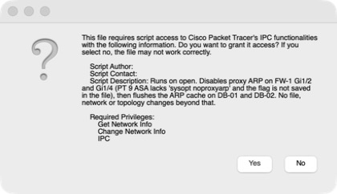

# DC1 verification record

**Status: ACCEPTED, with documented simulator limitations.** All results below come from the
saved `Advanced-DataCenter.pkt` running in Cisco Packet Tracer 9.0 (macOS) on 2026-10-24. They
are functional simulator results, not throughput or hardware-capacity measurements.

| Headline | Result |
| --- | --- |
| Final acceptance before save | **12 / 12 PASS** (8 permitted flows reach, 4 denied flows blocked) |
| Final acceptance after closing and reopening the saved file | **12 / 12 PASS** |
| Database same-VLAN test on a clean reopen, before any manual action | **4 / 4 replies**, ARP resolves to DB-02's real MAC |
| Failure drills (F01/F02 40-packet, F03–F05 50-packet streams) | Every **final-design** drill recovered all permitted flows. Two earlier-design drills (F03 v1, F05 v2) failed; those failures drove Changes 2 and 3 |
| Running configs exported | 10 / 10 network devices ([final-running-configs/](final-running-configs/)) |
| Known failing tests | D08, D19 (TCP return through the ASA); simulator model limitation, see below |

Terms used: **PASS** = observed exactly as expected. **FAIL** = observed and not as expected.
**NOT RUN** = no evidence collected. A ping test "passes" when a permitted flow gets replies
(first-packet ARP loss is normal) or a denied flow gets zero replies.

---

## 1. Acceptance tests (healthy network)

Source procedure: [VALIDATION.md](../VALIDATION.md).

| ID | Test | Observed | Status | Evidence |
| --- | --- | --- | --- | --- |
| B01 | 22 network nodes, 26 cables match the cable map | Built by script; link audit passed; source audit 26/26 | PASS | `../../automation/logs/build_topology.log`, `../../automation/logs/linkcheck.log`, [STATIC-AUDIT.md](STATIC-AUDIT.md) |
| B03 | LACP Po1 between cores | `Po1(SU)` with Gi0/1(P) Gi0/2(P), also after reopen | PASS | `raw/reopen/final_reopen_audit_v2.txt` |
| B04 | Rapid-PVST root placement | CORE-1 root VLAN 10/30/50/900, CORE-2 root 20/40; ACC-2 blocks Gi0/1 for VLAN 40 | PASS | `raw/tests/show_healthy_after_F03_v3.txt`, `final-running-configs/CORE-1.running-config.txt` |
| B05 / D15 | HSRPv2 roles | CORE-1 active 10/30/50/900, CORE-2 active 20; standby on the peer; no VLAN 40 group | PASS | `raw/reopen/final_reopen_audit_v2.txt` |
| B06 / D14 | OSPF area 0 on transit VLAN 900 | CORE-1 FULL with CORE-2 and FW-1, dead time 2–3 s (1/3 s timers) | PASS | `raw/reopen/final_reopen_audit_v2.txt` |
| D18 | Database subnet learned from the firewall | CORE-2: `O 10.10.40.0/24 via 10.255.0.4` | PASS | `raw/tests/show_F05_v3_routes_late.txt` |
| D13 | eBGP to two ISPs | EDGE-R1 has two Established neighbors, 4 prefixes each | PASS | `raw/reopen/final_reopen_audit_v2.txt` |
| D01 / B08 | DHCP via core relay | NOC-PC leased 10.10.10.100/24, gw 10.10.10.1, DNS 10.10.50.10 | PASS | `raw/tests/round1.txt` |
| D02 | Management → web tier | NOC-PC → WEB-01 6/8–7/8 per run (first packets lost to ARP) | PASS | `raw/tests/final_reopen_acceptance_v2.txt` |
| D03 / B09 / B10 | Internal DNS + HTTP | `nslookup web.dc1.lab` → 10.10.20.11; browser on `http://web.dc1.lab` shows WEB-01 page | PASS | `raw/tests/round3.txt`, [screenshot](../../docs/images/d03-web01-by-dns-name.jpg) |
| D04 | APP → DB through FW-1 | APP-01 → DB-02 8/8 | PASS | `raw/tests/final_reopen_acceptance_v2.txt` |
| D05 / B11 | WEB → DB denied | WEB-01 → DB-01 0/8 (INSIDE_IN deny) | PASS | same |
| D06 / B12 | SSH from management VLAN | NOC-PC SSH to CORE-1 and ACC-1 succeeded with `netadmin` | PASS | `raw/tests/dump_NOC-PC.txt`, `raw/tests/round3.txt` |
| D07 | SSH from untrusted host | WEB-01 → ACC-1: connection closed (VTY access-class) | PASS | `raw/tests/round3.txt` |
| D08 | Inside HTTP to Internet | Browser `http://www.internet.example`: Request Timeout | **FAIL** (simulator) | [screenshot](../../docs/images/d08-inside-http-to-internet-timeout-pt-limit.jpg), §4 |
| D09 | Internet → public web (static NAT) | INET-SRV browser `http://198.51.100.10` shows DMZ-WEB page | PASS | [screenshot](../../docs/images/d09-internet-to-dmz-web-static-nat.jpg) |
| D10 | Public DNS | `nslookup www.dc1-corp.com 198.51.100.11` → 198.51.100.10 | PASS | `raw/tests/round3.txt` |
| D11 | DMZ → management denied | DMZ-WEB → CORE-1 0/8 | PASS | `raw/tests/final_reopen_acceptance_v2.txt` |
| D12 | Internet ICMP to public web denied | INET-SRV → 198.51.100.10 0/8 | PASS | same |
| D16 | DB-initiated traffic denied | DB-01 → APP-01 0/6 | PASS | `raw/tests/round2.txt` |
| D17 | DB host DNS exception | Not separately executed | NOT RUN | — |
| D19 | APP → DB HTTP through FW-1 | Browser `http://10.10.40.11` from APP-01: Request Timeout | **FAIL** (simulator) | §4 |
| B13 | Inside → Internet (PAT) | SVC-MON → 203.0.113.10 7–8/8 | PASS | `raw/tests/final_reopen_acceptance_v2.txt` |
| B14 | Persistence across save/reopen | 12/12 after reopen; audit in §3 | PASS | §3 |

### Final 12-flow acceptance set

Run three times: before save, after the first reopen, and after the final reopen.

| Flow | Expect | Before save | Reopen #1 (module v1.0) | Final reopen (module v1.1) |
| --- | --- | --- | --- | --- |
| D02 NOC-PC → WEB-01 | permit | 7/8 | 6/8 | 6/8 |
| D04 APP-01 → DB-02 | permit | 8/8 | 8/8 | 8/8 |
| D05 WEB-01 → DB-01 | deny | 0/8 | 0/8 | 0/8 |
| X01 SVC-MON → Internet | permit | 8/8 | 8/8 | 7/8 |
| X04 DMZ-DNS → Internet | permit | 8/8 | 7/8 | 7/8 |
| S9 DB-01 → DB-02 (same VLAN) | permit | 8/8 | **0/8 FAIL** | **8/8** |
| D12 Internet → public web ICMP | deny | 0/8 | 0/8 | 0/8 |
| D11 DMZ-WEB → CORE-1 | deny | 0/8 | 0/8 | 0/8 |
| X09 WEB-02 → APP-01 | permit | 7/8 | 7/8 | 7/8 |
| X05 SVC-DNS → DB-01 | permit | 8/8 | 7/8 | 7/8 |
| X07 DB-02 → Internet | deny | 0/8 | 0/8 | 0/8 |
| X02 APP-02 → WEB-02 | permit | 7/8 | 6/8 | 6/8 |
| **Result** | | **12/12** | **11/12** | **12/12** |

Evidence: `raw/tests/final_acceptance.txt`, `raw/tests/final_reopen_acceptance.txt`,
`raw/tests/final_reopen_acceptance_v2.txt`. The 1–2 lost packets on permitted flows are first-packet
ARP resolution after a cold start.

---

## 2. Failure drills (redundancy stress test)

Method: 50-packet ping streams (40 for F01/F02) started on several hosts at once. The fault is
injected during the stream and restored afterwards, then a separate 8-packet verify round is run.
Only completed streams are counted; any stream still running at collection time is listed
separately and **not** counted as delivered. Fault scripts: `../../automation/drills.js`.

| Drill | Fault | Design | Delivered during fault | Lost per stream | After restore | Verdict |
| --- | --- | --- | --- | --- | --- | --- |
| S0 | none (baseline) | pre-fix | 150/150 on 5 completed streams; **S5, S7, S9 failed** (0 replies) | — | — | Found 3 bugs; fixed (§5) |
| F01 | CORE-1 Gi0/1 (one Po1 member) shut | final | **239/240** | 0–1 | 48/48 | PASS: Po1 stayed up on Gi0/2 |
| F02 | ACC-1 Gi0/1 uplink shut | final | **200/200** | 0 | 40/40 | PASS: STP moved to Gi0/2 hitlessly |
| F03 v1 | CORE-2 powered off | pre-Change-2 | 179/200; S3 (APP→DB) incomplete 8 ok / 15 timeouts | 5–6 | 37/40 | FAIL for DB: firewall db link hung off CORE-2 → **Change 2** |
| F04 | EDGE-R1 Gi0/0/1 (ISP2, BGP best path in `raw/baseline/EDGE-R1.txt`) shut | final | **130/150** | 10 per Internet stream | 24/24 | PASS: best path moved to ISP1 (AS 64501). The ISP2 session still showed up at capture time (BGP hold timer not yet expired), but its routes were no longer best |
| F03 v2 | CORE-2 powered off | Change 2 | **227/250** | 5–6 internal, 0 Internet | — | PASS |
| F05 v2 | CORE-1 powered off | Change 2 (static routes via HSRP VIP) | invalid: duplicate replies (63/50, 51/50); S3/S5 incomplete | — | — | FAIL: stale ARP for VIP-based routes → **Change 3** |
| F05 v3 | CORE-1 powered off | Change 3 (OSPF next hops) | **215/250** | 7 on every stream | healthy (`raw/tests/show_healthy_after_F05_v3.txt`) | PASS: all 5 flows recovered |
| F03 v3 | CORE-2 powered off | Change 3 (final) | **222/250** | 6–8 internal, 0 Internet | healthy (`raw/tests/show_healthy_after_F03_v3.txt`) | PASS |

Notes:

- Loss is counted in packets, not seconds, because Packet Tracer simulated time and wall time are
  not interchangeable. F05 v3's 7-packet loss can't be split between ARP warm-up and gateway
  failover from this data.
- HSRP timers: the 1/3 s setting does not survive a device reload in this simulator model (§4).
  CORE-2 was power-cycled in F03 v1 and CORE-1 in F05 v2. The final-design drills F05 v3 and
  F03 v3 therefore most likely ran on the default 3 s hello / 10 s hold. This is an inference
  from the reload behaviour; timers were not captured during the drills.
- No deny streams ran during F01–F05; denied-flow behaviour was tested in the acceptance runs.
- Healthy state after the last restore (Po1 SU, HSRP roles, OSPF FULL, FW-1 via CORE-1, BGP up):
  `raw/tests/show_healthy_after_F03_v3.txt`.
- Raw per-packet outputs: `raw/drills/*_during.txt`; fault-time show commands:
  `raw/drills/*_shows_fault*.txt`; summaries: `../../automation/logs/drill_*_collect.log`.

---

## 3. Saved-file persistence and the embedded fix module

The final `.pkt` contains one File Script Module script, `model-workarounds.js` v1.1
([source](../model-workarounds.js)). It runs automatically when the file opens, and Packet Tracer
shows a permission prompt describing what it does:

| Check after closing and reopening the saved file | Observed | Evidence |
| --- | --- | --- |
| Module runs on open | Debug log: `FW-1 Gi1/2 proxy ARP: true -> false`, `Gi1/4: true -> false`, `DB-01/DB-02 ARP cache flushed` | [screenshot](../../docs/images/file-module-debug-on-open.jpg) |
| DB-01 → DB-02 before touching anything | `arp -d` (from the module), ping 4/4, ARP = `0002.176d.7e35` (DB-02 real MAC) | [screenshot](../../docs/images/db01-db02-after-reopen.jpg) |
| FW-1 interfaces | All four data interfaces up/up with addresses | `raw/reopen/final_reopen_audit_v2.txt` |
| FW-1 routing | Inside /24s via CORE-1 (OSPF cost 2), default to EDGE-R1 | same |
| Core state | Po1(SU), HSRP roles as designed, OSPF FULL ×2 | same |
| BGP | Both ISP sessions Established | same |
| Services | DNS on (11 records), DHCP on (2 pools), WEB-01 page present, syslog + NTP on | same |
| Inventory | 24 objects (22 network nodes + 2 automatic power-distribution objects), 26 links | same |
| No build tooling left | Module list contains only `model-workarounds.js`; permissions IPC + Get/Change Network Info only; "allow opening if declined" set | screenshots + this record |
| Final save (canvas caption fix only), checked live | Opened from disk, module ran (`arp -d` visible on DB-01). DB-01 → DB-02 4/4; DB-01 → APP-01 0/4 (DB_IN deny) | manual console check at 20:27 (not saved as a file) |

**Finding from reopen #1 (fixed):** with module v1.0 (proxy-ARP fix only), the first reopen
failed S9. DB-01's ARP cache held DB-02's IP mapped to the firewall's db-interface MAC
(`0030.f27d.c504`), even though the proxy-ARP flags were already false. After `arp -d` on DB-01,
the same ping passed 4/4 and resolved the real MAC. So the firewall had stopped proxy-ARPing; one
entry learned before the fix ran was stale. Module v1.1 also flushes both DB hosts' ARP caches on
open. The final reopen then passed both the manual test and the full 12/12.
Evidence: `raw/tests/hostseq_DB-01_reopen_diag.txt`, `raw/tests/show_s9_reopen_diag.txt`,
`raw/tests/hostseq_DB-01_reopen_diag3_after.txt`.

Method note: the automated audit after the final reopen needed a temporary runner script and
wider module permissions. Those changes were never saved; the file was reopened from disk
afterwards and the module list re-checked. The temporary restart also re-ran the module's
ARP flush, so the manual DB-01 test above is the clean proof that the on-open behaviour works.

---

## 4. Known limitations (observed in this simulator, not hidden)

| # | Limitation | Effect | How it is handled |
| --- | --- | --- | --- |
| L1 | PT 9 ASA doesn't create return state for inside-initiated TCP across a lower-security or ACL-protected interface | **D08** (inside → Internet HTTP) and **D19** (APP → DB HTTP) time out. ICMP works because explicit echo-reply permits exist. Inbound-initiated TCP (D09) works. | Scoped TCP-return permits made both work during diagnosis but were **removed** from the final policy, because stateless return permits would weaken security. Recorded as FAIL, not hidden. |
| L2 | PT 3560 accepts SVI `ip access-group` but never enforces it; VACLs rejected | Core SVI ACLs can't segment the DB tier | **Change 1**: DB tier moved behind the ASA as its own zone (security level 90) |
| L3 | PT ASA answers ARP for other hosts on its segments; `sysopt noproxyarp` not implemented; the port flag is not saved in the `.pkt` | Same-VLAN DB traffic black-holed | Embedded File Script Module re-applies the flag and flushes DB ARP caches on every open (§3) |
| L4 | PT 3560 applies `standby <g> timers 1 3` at runtime but writes it to the config as `standby 0 timers 1 3` | Fast HSRP timers are lost after any reload or reopen; the saved lab runs default **3 s / 10 s** | Documented. `../../automation/logs/hsrp_probe.log` shows the runtime change and the mis-written line; `raw/tests/show_hsrp_detail_final.txt` shows 3/10 in the final lab |
| L5 | PT ASA doesn't restore `no shutdown` on its data interfaces after a device power-cycle | After power-cycling FW-1 alone, its interfaces come up admin-down | Re-enable per [CONFIGURATION-NOTES.md](../CONFIGURATION-NOTES.md). Opening the saved file keeps them up (§3). |
| L6 | PT ASA may keep its first OSPF result after a cold open | One reopen showed inside routes via CORE-2 (cost 101) instead of CORE-1 (cost 2) | Both paths are valid and traffic flowed; the final reopen chose CORE-1 |
| L7 | ISR4331 BGP model has no route-maps, prefix-lists or weight | No outbound non-transit filtering; best path is not policy-controlled | Documented in CONFIGURATION-NOTES |
| L8 | Single FW-1, EDGE-R1, DMZ-SW, one access switch per rack, single service servers | These remain single points of failure | Core/path redundancy only, not full-site HA |
| L9 | Packet Tracer console redraw can duplicate or trim long outputs | First ACC-1 export was missing its top lines | Re-captured page by page and rebuilt; size matches the device's own `Current configuration : 5439 bytes` |

---

## 5. Problems found and fixed during testing

| Symptom (test) | Root cause | Fix |
| --- | --- | --- |
| Po1 LACP suspended, STP inconsistent | Bundle formed before both ends had final config | `write memory` on all devices and power-cycle from startup-config → Po1(SU) |
| WEB → DB allowed (round 1 D05 FAIL) | SVI ACL not enforced by the PT 3560 | Change 1: DB zone behind FW-1 |
| DB replies dropped; DB PAT failing | ASA dropped echo-replies from the db zone | `DB_IN` echo-reply permit; DB Internet egress removed by design |
| S5/S7 inside/DMZ → Internet ping failed (S0) | ICMP inspection stopped matching after a policy edit | Explicit `OUTSIDE_IN` / `DMZ_IN` echo-reply permits |
| S9 DB-01 → DB-02 failed (S0) | ASA proxy ARP for DB hosts | API flag fix (module) + ARP flush |
| DB lost during CORE-2 outage (F03 v1) | FW db link terminated on CORE-2 | Change 2: FW inside/db links moved to dual-homed ToRs |
| Duplicate replies, stale paths in CORE-1 outage (F05 v2) | ASA static routes via HSRP VIP + core proxy ARP → stale per-host ARP | Change 3: OSPF next hops, 1/3 s transit timers, `no ip proxy-arp` on transit SVIs, CORE-2 SVI cost 100 |
| VLAN 900 not forwarding after trunk change | Newly allowed VLAN not active on running trunks | Bounced ToR uplinks |
| S9 failed after reopen #1 | Stale DB-01 ARP entry from before the fix ran | Module v1.1 flushes DB ARP caches on open |

---

## 6. Evidence index

- `final-running-configs/` — `show running-config` from all 10 network devices after final tests.
- `raw/baseline/` — first full show-command baseline (some captures have paging artifacts).
- `raw/tests/` — acceptance rounds, diagnostics, HSRP detail.
- `raw/drills/` — per-drill packet outputs and fault-time show commands.
- `raw/reopen/` — persistence audits after reopening the saved file.
- `../../automation/logs/` — script logs: build, config push, drills, exports, probes.
- `../../docs/images/` — screenshots referenced above.
